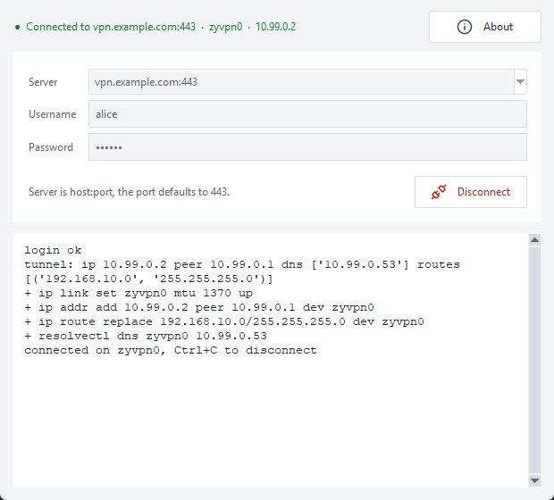
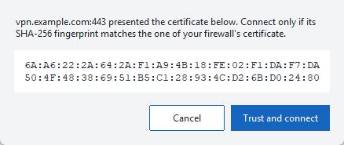
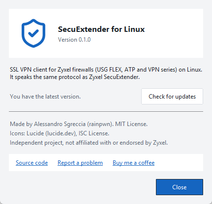

# zyxel-secuextender-linux

[](https://github.com/rainpwn/zyxel-secuextender-linux/releases/latest)

[](https://buymeacoffee.com/rainpwn)

An SSL VPN client for Zyxel firewalls (USG FLEX, ATP and VPN series running ZLD) that runs on Linux. It speaks the same protocol as Zyxel SecuExtender.

Tested on an ATP700. See [Status](#status) for details, and [report your firewall](https://github.com/rainpwn/zyxel-secuextender-linux/issues/new?template=device-report.yml) if it is not listed.

## Why this exists

I work from a Linux workstation, and I manage client networks protected by Zyxel firewalls. Their SSL VPN needs SecuExtender, and SecuExtender has no Linux version. I found no open-source client either, so I reverse engineered SecuExtender and wrote one.

`zyxel_sslvpn.py` is a single Python file with no dependencies outside the standard library.

## Usage

```
$ sudo ./zyxel_sslvpn.py vpn.example.com 443 alice --pin 00
Unexpected certificate, sha256=3f1c...e9
(if this is your firewall, run again with --pin 3f1c...e9)

$ sudo ./zyxel_sslvpn.py vpn.example.com 443 alice --pin 3f1c...e9
Password:
login ok
tunnel: ip 10.99.0.2 peer 10.99.0.1 dns ['10.99.0.53'] routes [('192.168.10.0', '255.255.255.0')]
+ ip link set zyvpn0 mtu 1370 up
+ ip addr add 10.99.0.2 peer 10.99.0.1 dev zyvpn0
+ ip route replace 192.168.10.0/255.255.255.0 dev zyvpn0
+ resolvectl dns zyvpn0 10.99.0.53
connected on zyvpn0, Ctrl+C to disconnect
```

Zyxel firewalls use self-signed certificates, so the client pins the certificate by its SHA-256 fingerprint instead of trusting a CA. Run it once with any value to print the fingerprint, check it, then pass it with `--pin`. `--insecure` skips the check and is meant for testing only.

The client:

- logs in and creates a `tun` interface with the address, routes and DNS servers the firewall pushes,
- logs out when you press Ctrl+C or when it receives SIGTERM (so it works under systemd),
- removes the interface, its routes and its DNS settings when it exits.

| Option | Meaning |
|---|---|
| `--pin SHA256` | Expected certificate fingerprint |
| `--insecure` | Do not check the certificate |
| `--dev NAME` | Name of the tun interface (default `zyvpn0`) |
| `--no-dns` | Ignore the DNS servers pushed by the firewall |
| `--password-stdin` | Read the password from the first line of stdin, disconnect when stdin is closed |
| `-v` | Print the configuration XML and the first packet received |

The password is read from the terminal, or from `ZYXEL_VPN_PASSWORD` for scripts.

## GUI

```
$ ./secuextender_gui.py
```

`secuextender_gui.py` is a Tk window around the client. Run it as your normal user, keeping it next to `zyxel_sslvpn.py`; it starts the client as root through `pkexec`. On every connection it shows the certificate fingerprint and asks you to confirm it.



<p>
  
  
</p>

Servers that connect successfully are saved, with the username, in `~/SecuExtender.xml`:

```xml
<?xml version="1.0" standalone="yes"?>
<SecuExtender>
  <server>
    <host>server.hostname:1443</host>
    <user>kevin</user>
  </server>
</SecuExtender>
```

The password is never saved.

## Status

| Feature | Status |
|---|---|
| Login, tunnel and traffic | Tested on an ATP700 |
| Routes and DNS pushed by the firewall | Applied as received; depends on the firewall's SSL VPN settings |
| IPv6 inside the tunnel | Not supported: the firewall pushes IPv4 settings only |
| Two-factor authentication, client certificates | Not implemented |

If it works or fails on another model, please [open an issue](https://github.com/rainpwn/zyxel-secuextender-linux/issues/new?template=device-report.yml) with the model, the firmware version and the output of `-v` with addresses redacted.

## Requirements

- Linux with Python 3.8 or later and the `tun` module
- Root, to create the interface and the routes
- `iproute2`, and `resolvectl` (systemd-resolved) if you want the pushed DNS servers applied
- For the GUI: Tk for Python (`python3-tk` on Debian and Ubuntu) and `pkexec` (polkit)

## How it works

[PROTOCOL.md](PROTOCOL.md) documents the protocol: login, tunnel setup, the configuration the firewall pushes, packet framing and logout.

## Legal

This is an independent project. It is not affiliated with, endorsed by or supported by Zyxel. Zyxel and SecuExtender are trademarks of their respective owners.

The protocol was recovered by decompiling SecuExtender for the sole purpose of interoperability with Linux, which Article 6 of EU Directive 2009/24/EC allows when the information is not otherwise available. This note is not legal advice. Use the software at your own risk.

## Support

If this tool saved you some time, you can [buy me a coffee](https://buymeacoffee.com/rainpwn).

## License

MIT. See [LICENSE](LICENSE).

Alessandro Sgreccia
